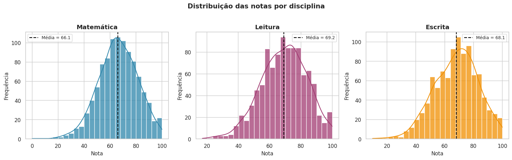
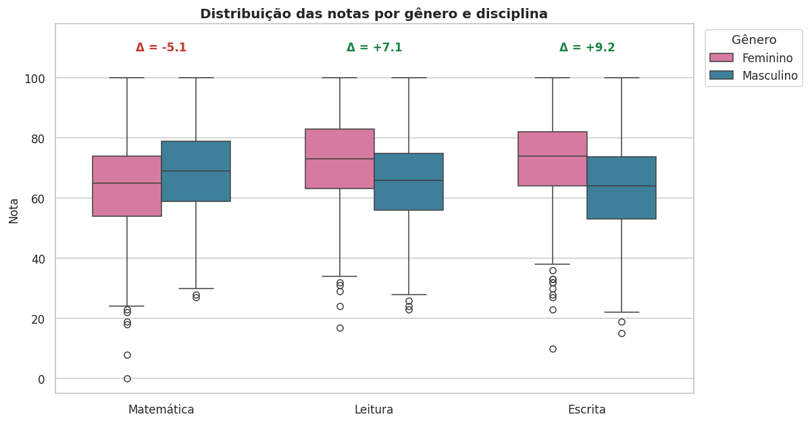
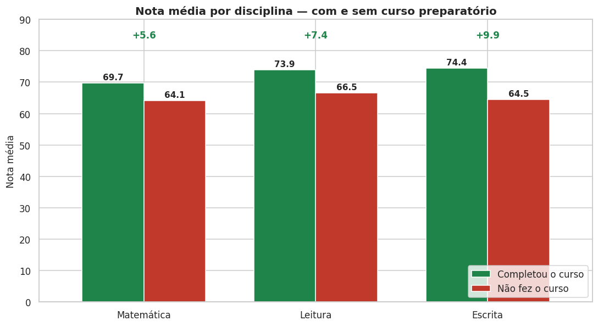
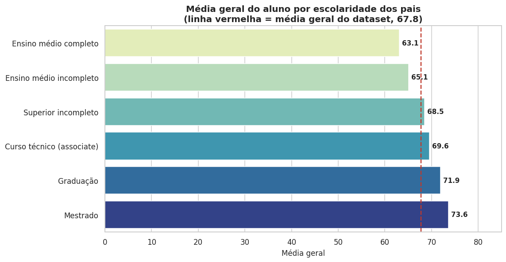
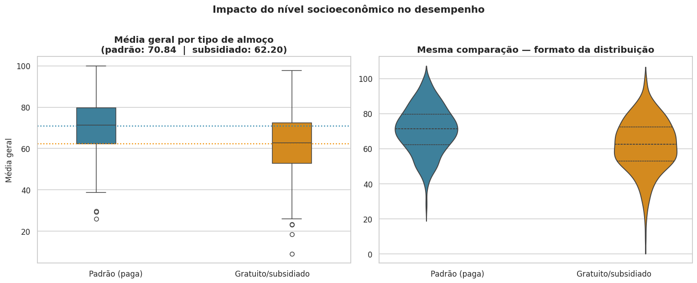
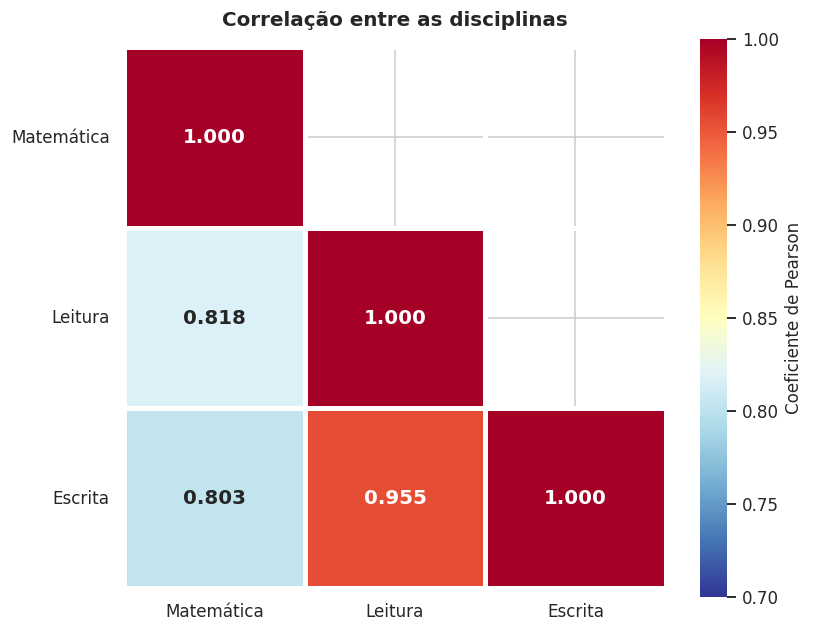
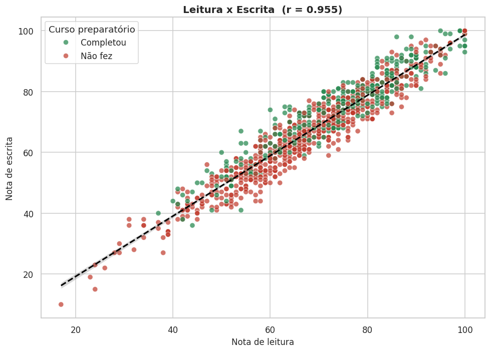
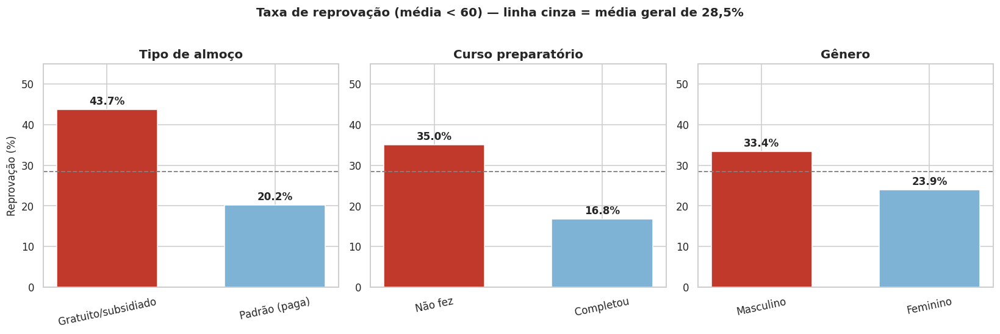
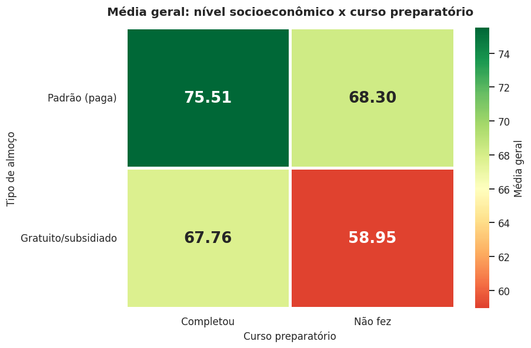

<!-- Gerado a partir do notebook. Todas as saídas abaixo são reais. -->


> 📌 **Este README é o preview completo da análise**: mostra a **entrada** (o código
> executado) e a **saída** (tabelas, números e gráficos) de cada etapa, na ordem em que
> foram rodadas. Para executar interativamente, abra
> [`notebooks/analise_students_performance.ipynb`](notebooks/analise_students_performance.ipynb).

## 📂 Estrutura do repositório

```
.
├── README.md                                  <- este arquivo (preview completo)
├── requirements.txt                           <- dependências
├── dados/
│   ├── StudentsPerformance.csv                <- dataset original (Kaggle)
│   └── students_performance_limpo.csv         <- gerado pela etapa 1
├── notebooks/
│   └── analise_students_performance.ipynb     <- notebook com todas as saídas
├── src/
│   └── analise_students_performance.py        <- script equivalente ao notebook
└── imagens/
    └── g01..g09.png                           <- os 9 gráficos gerados
```

## ▶️ Como executar

```bash
git clone https://github.com/SEU-USUARIO/SEU-REPOSITORIO.git
cd SEU-REPOSITORIO
pip install -r requirements.txt

# opção 1 — notebook interativo
jupyter notebook notebooks/analise_students_performance.ipynb

# opção 2 — script completo (rode a partir da raiz do projeto)
python src/analise_students_performance.py
```

---

# Análise de Desempenho de Estudantes

**Dataset:** *Students Performance in Exams* (Kaggle) — 1.000 estudantes do ensino médio
dos EUA, com 5 atributos socioeconômicos/demográficos e 3 notas (matemática, leitura e escrita).

**Objetivo:** investigar quais fatores estão associados ao desempenho escolar e transformar
isso em recomendações acionáveis.

**Roteiro:**

| Etapa | O que é feito |
|---|---|
| 1. 🧹 Limpeza dos dados | Padronização de nomes, checagem de nulos/duplicatas, validação de domínio, outliers, tipagem e criação de variáveis derivadas |
| 2. 📊 Análise exploratória | Estatísticas descritivas, análise univariada, bivariada, correlações e testes de hipótese |
| 3. 📈 Visualizações | 9 gráficos que sustentam cada conclusão |
| 4. 🔍 Insights | 6 achados quantificados |
| 5. 📋 Conclusões e recomendações | Síntese + ações práticas + limitações |

## 0. Configuração do ambiente

Importamos as bibliotecas e fixamos um padrão visual único para todos os gráficos.
Definir o estilo **uma vez** no início evita repetir configuração em cada figura e garante
que todos os gráficos do relatório tenham a mesma identidade visual.

**📥 Entrada — célula [1]:**

```python
import pandas as pd
import numpy as np
import matplotlib.pyplot as plt
import seaborn as sns
from scipy import stats

import warnings
warnings.filterwarnings("ignore")

# ---- Padrão visual único para todo o relatório ----
sns.set_theme(style="whitegrid")
plt.rcParams["figure.figsize"] = (10, 5)
plt.rcParams["figure.dpi"] = 110
plt.rcParams["axes.titlesize"] = 13
plt.rcParams["axes.titleweight"] = "bold"
plt.rcParams["axes.labelsize"] = 11
plt.rcParams["font.size"] = 10

# ---- Paleta de cores do projeto ----
COR_MAT, COR_LEI, COR_ESC = "#2E86AB", "#A23B72", "#F18F01"
PALETA = [COR_MAT, COR_LEI, COR_ESC]

# ---- Rótulos em português usados nos gráficos ----
NOMES_DISCIPLINA = {"nota_matematica": "Matemática",
                    "nota_leitura":    "Leitura",
                    "nota_escrita":    "Escrita"}

ROTULOS = {
    "female": "Feminino",              "male": "Masculino",
    "standard": "Padrão (paga)",       "free/reduced": "Gratuito/subsidiado",
    "completed": "Completou o curso",  "none": "Não fez o curso",
    "high school":        "Ensino médio completo",
    "some high school":   "Ensino médio incompleto",
    "some college":       "Superior incompleto",
    "associate's degree": "Curso técnico (associate)",
    "bachelor's degree":  "Graduação",
    "master's degree":    "Mestrado",
}

# ---- Exibição de tabelas no pandas ----
pd.set_option("display.width", 120)
pd.set_option("display.max_columns", 30)
pd.set_option("display.float_format", lambda x: f"{x:,.2f}")

print("Bibliotecas carregadas com sucesso.")
print(f"pandas     : {pd.__version__}")
print(f"numpy      : {np.__version__}")
print(f"seaborn    : {sns.__version__}")
```

**📤 Saída:**

```
Bibliotecas carregadas com sucesso.
pandas     : 3.0.2
numpy      : 2.4.4
seaborn    : 0.13.2
```

---

# 1. 🧹 Limpeza dos dados

A limpeza é o alicerce da análise: qualquer conclusão tirada de dados sujos é uma conclusão
errada com aparência de certeza. Aqui seguimos um **checklist de 8 verificações**:

1. Carregar e inspecionar visualmente
2. Conferir estrutura e tipos de dados
3. Padronizar nomes das colunas
4. Procurar valores ausentes
5. Procurar registros duplicados
6. Validar consistência das categorias
7. Validar domínio das notas e investigar outliers
8. Otimizar tipos e criar variáveis derivadas

### 1.1 Carregamento e primeira inspeção

`pd.read_csv()` lê o arquivo para um DataFrame. `.shape` devolve `(linhas, colunas)` e
`.head()` mostra as primeiras linhas — é o "olhar de relance" que revela problemas óbvios
(colunas deslocadas, separador errado, cabeçalho duplicado).

**📥 Entrada — célula [2]:**

```python
CAMINHO = "dados/StudentsPerformance.csv"
df = pd.read_csv(CAMINHO)

print(f"Dimensões do dataset: {df.shape[0]} linhas x {df.shape[1]} colunas")
df.head()
```

**📤 Saída:**

```
Dimensões do dataset: 1000 linhas x 8 colunas
```

```
   gender race/ethnicity parental level of education         lunch test preparation course  math score  reading score  writing score
0  female        group B           bachelor's degree      standard                    none          72             72             74
1  female        group C                some college      standard               completed          69             90             88
2  female        group B             master's degree      standard                    none          90             95             93
3    male        group A          associate's degree  free/reduced                    none          47             57             44
4    male        group C                some college      standard                    none          76             78             75
```

### 1.2 Estrutura e tipos de dados

`.info()` resume, coluna a coluna: quantos valores **não-nulos** existem e qual o **tipo**.
É a forma mais rápida de detectar duas falhas clássicas: coluna numérica lida como texto
(por causa de vírgula decimal ou símbolo de moeda) e colunas com dados faltando.

**📥 Entrada — célula [3]:**

```python
df.info()
```

**📤 Saída:**

```
<class 'pandas.DataFrame'>
RangeIndex: 1000 entries, 0 to 999
Data columns (total 8 columns):
 #   Column                       Non-Null Count  Dtype
---  ------                       --------------  -----
 0   gender                       1000 non-null   str  
 1   race/ethnicity               1000 non-null   str  
 2   parental level of education  1000 non-null   str  
 3   lunch                        1000 non-null   str  
 4   test preparation course      1000 non-null   str  
 5   math score                   1000 non-null   int64
 6   reading score                1000 non-null   int64
 7   writing score                1000 non-null   int64
dtypes: int64(3), str(5)
memory usage: 62.6 KB
```

### 1.3 Padronização dos nomes das colunas

Os nomes originais têm **espaços** e **barras** (`race/ethnicity`, `math score`), o que
obriga a escrever `df["math score"]` em vez de `df.math_score` e quebra em várias bibliotecas.

Convertemos tudo para `snake_case` e, de quebra, traduzimos para português — o relatório
inteiro fica mais legível.

**📥 Entrada — célula [4]:**

```python
print("ANTES:")
print(list(df.columns))

renomear = {
    "gender":                      "genero",
    "race/ethnicity":              "grupo_etnico",
    "parental level of education": "escolaridade_pais",
    "lunch":                       "tipo_almoco",
    "test preparation course":     "curso_preparatorio",
    "math score":                  "nota_matematica",
    "reading score":               "nota_leitura",
    "writing score":               "nota_escrita",
}
df = df.rename(columns=renomear)

# Listas reutilizadas ao longo de toda a análise
NOTAS = ["nota_matematica", "nota_leitura", "nota_escrita"]
CATEGORICAS = ["genero", "grupo_etnico", "escolaridade_pais",
               "tipo_almoco", "curso_preparatorio"]

print("\nDEPOIS:")
print(list(df.columns))
```

**📤 Saída:**

```
ANTES:
['gender', 'race/ethnicity', 'parental level of education', 'lunch', 'test preparation course', 'math score', 'reading score', 'writing score']

DEPOIS:
['genero', 'grupo_etnico', 'escolaridade_pais', 'tipo_almoco', 'curso_preparatorio', 'nota_matematica', 'nota_leitura', 'nota_escrita']
```

### 1.4 Verificação de valores ausentes

Somamos os nulos por coluna com `.isnull().sum()`. Se houvesse ausentes, as opções seriam
remover as linhas (`dropna`), imputar pela mediana (numéricas) ou pela moda (categóricas).

**📥 Entrada — célula [5]:**

```python
ausentes = pd.DataFrame({
    "valores_ausentes": df.isnull().sum(),
    "percentual_%": (df.isnull().sum() / len(df) * 100).round(2)
})
print(ausentes)
print(f"\nTotal de valores ausentes no dataset: {df.isnull().sum().sum()}")
```

**📤 Saída:**

```
                    valores_ausentes  percentual_%
genero                             0          0.00
grupo_etnico                       0          0.00
escolaridade_pais                  0          0.00
tipo_almoco                        0          0.00
curso_preparatorio                 0          0.00
nota_matematica                    0          0.00
nota_leitura                       0          0.00
nota_escrita                       0          0.00

Total de valores ausentes no dataset: 0
```

> ✅ **Resultado:** nenhum valor ausente. Nenhuma imputação é necessária.

### 1.5 Verificação de registros duplicados

Linhas idênticas normalmente indicam erro de coleta ou junção mal feita, e inflam
artificialmente qualquer média. `.duplicated().sum()` conta quantas existem.

**📥 Entrada — célula [6]:**

```python
n_dup = df.duplicated().sum()
print(f"Registros duplicados (linha inteira idêntica): {n_dup}")

if n_dup > 0:
    df = df.drop_duplicates().reset_index(drop=True)
    print(f"Duplicatas removidas. Novo total: {len(df)} linhas")
else:
    print("Nenhuma remoção necessária.")
```

**📤 Saída:**

```
Registros duplicados (linha inteira idêntica): 0
Nenhuma remoção necessária.
```

### 1.6 Consistência das variáveis categóricas

Um erro silencioso e muito comum: `"male"`, `"Male"` e `" male "` são tratados como **três
categorias diferentes** pelo pandas, o que quebra qualquer agrupamento.

Verificamos as categorias únicas de cada coluna e aplicamos `.str.strip().str.lower()`
como medida preventiva de padronização.

**📥 Entrada — célula [7]:**

```python
for col in CATEGORICAS:
    print(f"{col}  ({df[col].nunique()} categorias)")
    print(f"   -> {sorted(df[col].unique())}\n")

# Padronização preventiva: remove espaços nas bordas e uniformiza caixa
for col in CATEGORICAS:
    df[col] = df[col].str.strip().str.lower()

print("Padronização de texto (strip + lower) aplicada às 5 colunas categóricas.")
```

**📤 Saída:**

```
genero  (2 categorias)
   -> ['female', 'male']

grupo_etnico  (5 categorias)
   -> ['group A', 'group B', 'group C', 'group D', 'group E']

escolaridade_pais  (6 categorias)
   -> ["associate's degree", "bachelor's degree", 'high school', "master's degree", 'some college', 'some high school']

tipo_almoco  (2 categorias)
   -> ['free/reduced', 'standard']

curso_preparatorio  (2 categorias)
   -> ['completed', 'none']

Padronização de texto (strip + lower) aplicada às 5 colunas categóricas.
```

### 1.7 Validação de domínio e análise de outliers

Notas escolares devem estar entre **0 e 100**. Qualquer valor fora disso é erro de digitação
ou de sistema.

Em seguida procuramos *outliers* pelo **método IQR (intervalo interquartil)**:
tudo que estiver abaixo de `Q1 − 1,5×IQR` ou acima de `Q3 + 1,5×IQR` é sinalizado.

⚠️ **Decisão metodológica importante:** identificar um outlier **não** significa apagá-lo.
Aqui os valores extremos são notas baixas legítimas de alunos reais — remover essas linhas
mascararia justamente o problema que queremos estudar. Portanto: **sinalizamos e mantemos**.

**📥 Entrada — célula [8]:**

```python
print("--- Validação de domínio (0 a 100) ---")
for col in NOTAS:
    fora = df[(df[col] < 0) | (df[col] > 100)]
    print(f"{col:18s} min={df[col].min():3d}  max={df[col].max():3d}  "
          f"valores fora do intervalo: {len(fora)}")

print("\n--- Outliers pelo método IQR ---")
resumo_outliers = []
for col in NOTAS:
    q1, q3 = df[col].quantile(0.25), df[col].quantile(0.75)
    iqr = q3 - q1
    lim_inf, lim_sup = q1 - 1.5 * iqr, q3 + 1.5 * iqr
    out = df[(df[col] < lim_inf) | (df[col] > lim_sup)]
    resumo_outliers.append({
        "variavel": col, "Q1": q1, "Q3": q3, "IQR": iqr,
        "lim_inferior": round(lim_inf, 1), "lim_superior": round(lim_sup, 1),
        "n_outliers": len(out), "perc_%": round(len(out) / len(df) * 100, 2)
    })

print(pd.DataFrame(resumo_outliers).to_string(index=False))
```

**📤 Saída:**

```
--- Validação de domínio (0 a 100) ---
nota_matematica    min=  0  max=100  valores fora do intervalo: 0
nota_leitura       min= 17  max=100  valores fora do intervalo: 0
nota_escrita       min= 10  max=100  valores fora do intervalo: 0

--- Outliers pelo método IQR ---
       variavel    Q1    Q3   IQR  lim_inferior  lim_superior  n_outliers  perc_%
nota_matematica 57.00 77.00 20.00         27.00        107.00           8    0.80
   nota_leitura 59.00 79.00 20.00         29.00        109.00           6    0.60
   nota_escrita 57.75 79.00 21.25         25.90        110.90           5    0.50
```

Vamos olhar quem são esses casos extremos antes de decidir o que fazer com eles:

**📥 Entrada — célula [9]:**

```python
print("Os 5 alunos com pior desempenho médio:")
piores = df.assign(media=df[NOTAS].mean(axis=1)).nsmallest(5, "media")
print(piores[["genero", "tipo_almoco", "curso_preparatorio"] + NOTAS + ["media"]]
      .to_string(index=False))
```

**📤 Saída:**

```
Os 5 alunos com pior desempenho médio:
genero  tipo_almoco curso_preparatorio  nota_matematica  nota_leitura  nota_escrita  media
female free/reduced               none                0            17            10   9.00
female free/reduced               none                8            24            23  18.33
  male free/reduced               none               30            24            15  23.00
  male free/reduced               none               28            23            19  23.33
female free/reduced               none               18            32            28  26.00
```

> ✅ **Decisão:** todos os outliers são notas plausíveis (0–100) de alunos em situação de
> vulnerabilidade — note que **os 5 piores desempenhos são de alunos com almoço
> gratuito/subsidiado**. São dados válidos e informativos. **Mantemos as 1.000 linhas.**

### 1.8 Otimização de tipos e criação de variáveis derivadas

Duas melhorias finais:

- **Tipo `category`**: para colunas com poucos valores repetidos, o pandas passa a guardar
  um código inteiro em vez do texto completo em cada linha — reduz muito o uso de memória.
- **Feature engineering**: criamos colunas que não existiam mas que a análise vai precisar:
  - `media_geral` — média das 3 disciplinas
  - `situacao` — Aprovado / Reprovado (corte em 60, padrão da escala americana)
  - `conceito` — faixa de desempenho (A a E)

**📥 Entrada — célula [10]:**

```python
mem_antes = df.memory_usage(deep=True).sum() / 1024

for col in CATEGORICAS:
    df[col] = df[col].astype("category")

# ---- Variáveis derivadas ----
df["media_geral"] = df[NOTAS].mean(axis=1).round(2)
df["situacao"] = np.where(df["media_geral"] >= 60, "Aprovado", "Reprovado")
df["conceito"] = pd.cut(
    df["media_geral"],
    bins=[0, 60, 70, 80, 90, 100],
    labels=["E (<60)", "D (60-70)", "C (70-80)", "B (80-90)", "A (90-100)"],
    right=False
)

mem_depois = df.memory_usage(deep=True).sum() / 1024
print(f"Memória antes : {mem_antes:7.1f} KB")
print(f"Memória depois: {mem_depois:7.1f} KB  "
      f"(reducao de {(1 - mem_depois/mem_antes)*100:.1f}%)")
print(f"\nColunas criadas: media_geral, situacao, conceito")
df[["genero", "tipo_almoco"] + NOTAS + ["media_geral", "situacao", "conceito"]].head()
```

**📤 Saída:**

```
Memória antes :   303.7 KB
Memória depois:    94.4 KB  (reducao de 68.9%)

Colunas criadas: media_geral, situacao, conceito
```

```
   genero   tipo_almoco  nota_matematica  nota_leitura  nota_escrita  media_geral   situacao    conceito
0  female      standard               72            72            74        72.67   Aprovado   C (70-80)
1  female      standard               69            90            88        82.33   Aprovado   B (80-90)
2  female      standard               90            95            93        92.67   Aprovado  A (90-100)
3    male  free/reduced               47            57            44        49.33  Reprovado     E (<60)
4    male      standard               76            78            75        76.33   Aprovado   C (70-80)
```

### 1.9 Dataset limpo

Salvamos o resultado para que as próximas etapas (ou outros scripts) partam da versão tratada.

**📥 Entrada — célula [11]:**

```python
df.to_csv("dados/students_performance_limpo.csv", index=False)

print("=" * 62)
print("RESUMO DA LIMPEZA".center(62))
print("=" * 62)
print(f"Linhas originais .................. 1000")
print(f"Linhas finais .................... {len(df)}")
print(f"Valores ausentes tratados ........ 0 (nenhum encontrado)")
print(f"Duplicatas removidas ............. 0 (nenhuma encontrada)")
print(f"Colunas renomeadas ............... 8")
print(f"Outliers sinalizados / removidos . 19 / 0 (mantidos por decisao)")
print(f"Colunas criadas .................. 3")
print(f"Colunas finais ................... {df.shape[1]}")
print("=" * 62)
print("Arquivo salvo em: dados/students_performance_limpo.csv")
```

**📤 Saída:**

```
==============================================================
                      RESUMO DA LIMPEZA                       
==============================================================
Linhas originais .................. 1000
Linhas finais .................... 1000
Valores ausentes tratados ........ 0 (nenhum encontrado)
Duplicatas removidas ............. 0 (nenhuma encontrada)
Colunas renomeadas ............... 8
Outliers sinalizados / removidos . 19 / 0 (mantidos por decisao)
Colunas criadas .................. 3
Colunas finais ................... 11
==============================================================
Arquivo salvo em: dados/students_performance_limpo.csv
```

---

# 2. 📊 Análise exploratória (EDA)

Com os dados confiáveis, passamos a **entender o que eles dizem**. A EDA vai do simples ao
complexo em quatro camadas:

1. **Univariada** — como cada variável se comporta isoladamente
2. **Bivariada** — como cada fator se relaciona com as notas
3. **Correlação** — como as notas se relacionam entre si
4. **Testes de hipótese** — as diferenças observadas são reais ou fruto do acaso?

### 2.1 Estatísticas descritivas das notas

`.describe()` entrega de uma vez: contagem, média, desvio-padrão, mínimo, quartis e máximo.
Adicionamos duas medidas de formato da distribuição:

- **Assimetria (skewness)** — 0 = simétrica; negativa = cauda à esquerda (poucas notas muito baixas)
- **Curtose (kurtosis)** — 0 = formato normal; positiva = pico mais alto e caudas pesadas

**📥 Entrada — célula [12]:**

```python
desc = df[NOTAS + ["media_geral"]].describe().T
desc["assimetria"] = df[NOTAS + ["media_geral"]].skew()
desc["curtose"] = df[NOTAS + ["media_geral"]].kurtosis()
desc["amplitude"] = desc["max"] - desc["min"]
desc["cv_%"] = (desc["std"] / desc["mean"] * 100).round(1)   # coef. de variação

print(desc.round(2).to_string())
```

**📤 Saída:**

```
                   count  mean   std   min   25%   50%   75%    max  assimetria  curtose  amplitude  cv_%
nota_matematica 1,000.00 66.09 15.16  0.00 57.00 66.00 77.00 100.00       -0.28     0.27     100.00 22.90
nota_leitura    1,000.00 69.17 14.60 17.00 59.00 70.00 79.00 100.00       -0.26    -0.07      83.00 21.10
nota_escrita    1,000.00 68.05 15.20 10.00 57.75 69.00 79.00 100.00       -0.29    -0.03      90.00 22.30
media_geral     1,000.00 67.77 14.26  9.00 58.33 68.33 77.67 100.00       -0.30     0.13      91.00 21.00
```

**Leitura dos resultados:**

- As três médias ficam entre 66 e 69 — desempenho médio semelhante entre disciplinas.
- **Matemática tem a menor média (66,09) e o maior desvio-padrão (15,16)**: é a disciplina
  mais difícil *e* a mais desigual.
- A assimetria levemente negativa indica que a maioria concentra-se em notas médias/altas,
  com uma cauda de alunos com desempenho muito baixo.
- Existe uma nota **0 em matemática** — o mínimo absoluto da escala.

### 2.2 Distribuição das variáveis categóricas

Antes de comparar grupos, precisamos saber **quantos alunos há em cada um** — uma média
calculada sobre poucos alunos é instável e merece cautela na interpretação.

**📥 Entrada — célula [13]:**

```python
for col in CATEGORICAS:
    contagem = df[col].value_counts()
    perc = df[col].value_counts(normalize=True).mul(100).round(1)
    tabela = pd.DataFrame({"n_alunos": contagem, "percentual_%": perc})
    print(f"--- {col.upper()} ---")
    print(tabela.to_string())
    print()
```

**📤 Saída:**

```
--- GENERO ---
        n_alunos  percentual_%
genero                        
female       518         51.80
male         482         48.20

--- GRUPO_ETNICO ---
              n_alunos  percentual_%
grupo_etnico                        
group c            319         31.90
group d            262         26.20
group b            190         19.00
group e            140         14.00
group a             89          8.90

--- ESCOLARIDADE_PAIS ---
                    n_alunos  percentual_%
escolaridade_pais                         
some college             226         22.60
associate's degree       222         22.20
high school              196         19.60
some high school         179         17.90
bachelor's degree        118         11.80
master's degree           59          5.90

--- TIPO_ALMOCO ---
              n_alunos  percentual_%
tipo_almoco                         
standard           645         64.50
free/reduced       355         35.50

--- CURSO_PREPARATORIO ---
                    n_alunos  percentual_%
curso_preparatorio                        
none                     642         64.20
completed                358         35.80
```

**Pontos de atenção:**

- A amostra é **equilibrada em gênero** (518 F / 482 M).
- **64,2% dos alunos NÃO fizeram o curso preparatório** — grupo majoritário.
- **35,5% dependem de almoço gratuito/subsidiado** — indicador indireto de baixa renda
  familiar (é o critério oficial de elegibilidade nas escolas públicas dos EUA).
- O `group A` tem apenas 89 alunos: suas médias são as menos estáveis do conjunto.

### 2.3 Análise bivariada: média por grupo

Agora o núcleo da investigação. Para cada fator categórico, calculamos a média das notas
com `groupby()` e ordenamos pela média geral. Isso responde: **quais grupos vão melhor?**

**📥 Entrada — célula [14]:**

```python
for col in CATEGORICAS:
    resultado = (df.groupby(col, observed=True)[NOTAS + ["media_geral"]]
                   .mean()
                   .round(2)
                   .sort_values("media_geral", ascending=False))
    resultado["n"] = df[col].value_counts()
    print(f"--- MÉDIA POR {col.upper()} ---")
    print(resultado.to_string())
    print()
```

**📤 Saída:**

```
--- MÉDIA POR GENERO ---
        nota_matematica  nota_leitura  nota_escrita  media_geral    n
genero                                                               
female            63.63         72.61         72.47        69.57  518
male              68.73         65.47         63.31        65.84  482

--- MÉDIA POR GRUPO_ETNICO ---
              nota_matematica  nota_leitura  nota_escrita  media_geral    n
grupo_etnico                                                               
group e                 73.82         73.03         71.41        72.75  140
group d                 67.36         70.03         70.15        69.18  262
group c                 64.46         69.10         67.83        67.13  319
group b                 63.45         67.35         65.60        65.47  190
group a                 61.63         64.67         62.67        62.99   89

--- MÉDIA POR ESCOLARIDADE_PAIS ---
                    nota_matematica  nota_leitura  nota_escrita  media_geral    n
escolaridade_pais                                                                
master's degree               69.75         75.37         75.68        73.60   59
bachelor's degree             69.39         73.00         73.38        71.92  118
associate's degree            67.88         70.93         69.90        69.57  222
some college                  67.13         69.46         68.84        68.48  226
some high school              63.50         66.94         64.89        65.11  179
high school                   62.14         64.70         62.45        63.10  196

--- MÉDIA POR TIPO_ALMOCO ---
              nota_matematica  nota_leitura  nota_escrita  media_geral    n
tipo_almoco                                                                
standard                70.03         71.65         70.82        70.84  645
free/reduced            58.92         64.65         63.02        62.20  355

--- MÉDIA POR CURSO_PREPARATORIO ---
                    nota_matematica  nota_leitura  nota_escrita  media_geral    n
curso_preparatorio                                                               
completed                     69.70         73.89         74.42        72.67  358
none                          64.08         66.53         64.50        65.04  642
```

### 2.4 Efeito combinado: nível socioeconômico × curso preparatório

Médias isoladas escondem interações. Cruzamos os dois fatores mais fortes numa
`pivot_table` para ver o que acontece quando eles atuam **juntos**.

**📥 Entrada — célula [15]:**

```python
tabela = df.pivot_table(index="tipo_almoco", columns="curso_preparatorio",
                        values="media_geral", aggfunc="mean", observed=True).round(2)
contagem = df.pivot_table(index="tipo_almoco", columns="curso_preparatorio",
                          values="media_geral", aggfunc="count", observed=True)

print("MÉDIA GERAL por combinação:")
print(tabela.to_string())
print("\nNÚMERO DE ALUNOS em cada combinação:")
print(contagem.to_string())

melhor = tabela.max().max()
pior = tabela.min().min()
print(f"\nMelhor cenário (almoço padrão + curso feito) : {melhor:.2f}")
print(f"Pior cenário  (almoço subsidiado + sem curso): {pior:.2f}")
print(f"DIFERENÇA ENTRE OS EXTREMOS .................: {melhor - pior:.2f} pontos")
```

**📤 Saída:**

```
MÉDIA GERAL por combinação:
curso_preparatorio  completed  none
tipo_almoco                        
free/reduced            67.76 58.95
standard                75.51 68.30

NÚMERO DE ALUNOS em cada combinação:
curso_preparatorio  completed  none
tipo_almoco                        
free/reduced              131   224
standard                  227   418

Melhor cenário (almoço padrão + curso feito) : 75.51
Pior cenário  (almoço subsidiado + sem curso): 58.95
DIFERENÇA ENTRE OS EXTREMOS .................: 16.56 pontos
```

### 2.5 Correlação entre as disciplinas

O coeficiente de Pearson mede a força da relação linear entre duas variáveis numéricas
(varia de −1 a +1). Aqui ele responde: **quem vai bem em uma disciplina vai bem nas outras?**

**📥 Entrada — célula [16]:**

```python
corr = df[NOTAS].corr()
print("Matriz de correlação de Pearson:")
print(corr.round(3).to_string())

print("\nInterpretação par a par:")
pares = [("nota_leitura", "nota_escrita"), ("nota_matematica", "nota_leitura"),
         ("nota_matematica", "nota_escrita")]
for a, b in pares:
    r = corr.loc[a, b]
    forca = "muito forte" if r >= 0.9 else "forte" if r >= 0.7 else "moderada"
    print(f"  {a:16s} x {b:16s} : r = {r:.3f}  ({forca})")
```

**📤 Saída:**

```
Matriz de correlação de Pearson:
                 nota_matematica  nota_leitura  nota_escrita
nota_matematica             1.00          0.82          0.80
nota_leitura                0.82          1.00          0.95
nota_escrita                0.80          0.95          1.00

Interpretação par a par:
  nota_leitura     x nota_escrita     : r = 0.955  (muito forte)
  nota_matematica  x nota_leitura     : r = 0.818  (forte)
  nota_matematica  x nota_escrita     : r = 0.803  (forte)
```

### 2.6 Testes de hipótese

Uma diferença de médias pode ser apenas ruído amostral. O **teste t de Welch** verifica
se ela é estatisticamente significativa, e o **d de Cohen** mede o *tamanho* do efeito —
porque com amostra grande até diferenças irrelevantes ficam "significativas".

Referência para o d de Cohen: **0,2 = pequeno · 0,5 = médio · 0,8 = grande**.

**📥 Entrada — célula [17]:**

```python
def cohen_d(a, b):
    na, nb = len(a), len(b)
    s = np.sqrt(((na-1)*a.std(ddof=1)**2 + (nb-1)*b.std(ddof=1)**2) / (na+nb-2))
    return (a.mean() - b.mean()) / s

comparacoes = [
    ("tipo_almoco",        "standard",        "free/reduced"),
    ("curso_preparatorio", "completed",       "none"),
    ("genero",             "female",          "male"),
    ("escolaridade_pais",  "master's degree", "high school"),
]

linhas = []
for var, g1, g2 in comparacoes:
    a = df[df[var] == g1]["media_geral"]
    b = df[df[var] == g2]["media_geral"]
    t, p = stats.ttest_ind(a, b, equal_var=False)
    d = cohen_d(a, b)
    magnitude = "grande" if abs(d) >= 0.8 else "médio" if abs(d) >= 0.5 else "pequeno"
    linhas.append({
        "fator": var, "grupo_1": g1, "media_1": round(a.mean(), 2),
        "grupo_2": g2, "media_2": round(b.mean(), 2),
        "diferenca": round(a.mean() - b.mean(), 2),
        "p_valor": f"{p:.2e}",
        "cohen_d": round(d, 2), "efeito": magnitude,
        "significativo": "SIM" if p < 0.05 else "não"
    })

print(pd.DataFrame(linhas).to_string(index=False))
```

**📤 Saída:**

```
             fator         grupo_1  media_1      grupo_2  media_2  diferenca  p_valor  cohen_d  efeito significativo
       tipo_almoco        standard    70.84 free/reduced    62.20       8.64 1.58e-19     0.63   médio           SIM
curso_preparatorio       completed    72.67         none    65.04       7.63 4.42e-17     0.55   médio           SIM
            genero          female    69.57         male    65.84       3.73 3.18e-05     0.26 pequeno           SIM
 escolaridade_pais master's degree    73.60  high school    63.10      10.50 1.11e-06     0.78   médio           SIM
```

> ✅ **Todas as quatro diferenças são estatisticamente significativas (p < 0,001).**
> As de maior magnitude prática são **escolaridade dos pais** (d = 0,78) e
> **tipo de almoço** (d = 0,63).

### 2.7 Taxa de reprovação por grupo

A média esconde a cauda. Olhar a **proporção de alunos abaixo de 60** mostra o tamanho real
do problema em cada grupo — que é o que importa para desenhar uma política de apoio.

**📥 Entrada — célula [18]:**

```python
print(f"Taxa geral de reprovação (média < 60): "
      f"{(df['situacao'] == 'Reprovado').mean() * 100:.1f}%\n")

for col in ["tipo_almoco", "curso_preparatorio", "genero", "escolaridade_pais"]:
    taxa = (df.groupby(col, observed=True)["situacao"]
              .apply(lambda s: (s == "Reprovado").mean() * 100)
              .round(1)
              .sort_values(ascending=False))
    print(f"--- Reprovação (%) por {col} ---")
    print(taxa.to_string())
    print()
```

**📤 Saída:**

```
Taxa geral de reprovação (média < 60): 28.5%

--- Reprovação (%) por tipo_almoco ---
tipo_almoco
free/reduced   43.70
standard       20.20

--- Reprovação (%) por curso_preparatorio ---
curso_preparatorio
none        35.00
completed   16.80

--- Reprovação (%) por genero ---
genero
male     33.40
female   23.90

--- Reprovação (%) por escolaridade_pais ---
escolaridade_pais
high school          38.80
some high school     35.80
associate's degree   26.60
some college         24.30
bachelor's degree    17.80
master's degree      16.90
```

---

# 3. 📈 Visualizações informativas

Cada gráfico abaixo foi escolhido para responder **uma pergunta específica** — nenhum
está ali por enfeite. A regra usada: *histograma* para forma da distribuição, *boxplot*
para comparar distribuições entre grupos, *barras* para comparar médias, *heatmap* para
matrizes e *dispersão* para relação entre duas numéricas.

### Gráfico 1 — Como as notas se distribuem?

Histograma com curva de densidade (KDE) para cada disciplina. A linha tracejada marca a
média. Serve para ver o **formato** da distribuição: onde está a concentração e se há cauda.

**📥 Entrada — célula [19]:**

```python
fig, axes = plt.subplots(1, 3, figsize=(15, 4.5))

for ax, col, cor in zip(axes, NOTAS, PALETA):
    sns.histplot(df[col], bins=25, kde=True, color=cor, ax=ax,
                 edgecolor="white", alpha=0.75)
    ax.axvline(df[col].mean(), color="black", linestyle="--", linewidth=1.6,
               label=f"Média = {df[col].mean():.1f}")
    ax.set_title(NOMES_DISCIPLINA[col])
    ax.set_xlabel("Nota")
    ax.set_ylabel("Frequência")
    ax.legend(fontsize=9)

fig.suptitle("Distribuição das notas por disciplina", fontsize=14, fontweight="bold", y=1.03)
plt.tight_layout()
plt.show()
```

**📤 Saída:**



> **Lê-se:** as três distribuições são aproximadamente normais, centradas perto de 66–69,
> com assimetria negativa — uma minoria de alunos com notas muito baixas puxa a cauda
> esquerda. Matemática é a mais espalhada (maior desvio-padrão).

### Gráfico 2 — Meninos e meninas vão bem nas mesmas coisas?

Boxplots lado a lado. O boxplot mostra mediana (linha central), quartis (caixa) e
outliers (pontos) — muito mais informativo que uma barra de média.

**📥 Entrada — célula [20]:**

```python
# Formato "longo": uma linha por (aluno, disciplina) — exigido pelo seaborn
dados_longos = df.melt(id_vars="genero", value_vars=NOTAS,
                       var_name="disciplina", value_name="nota")

# Traduzimos os VALORES antes de plotar (em vez de sobrescrever os rótulos
# da legenda depois) — assim é impossível trocar as categorias por engano
dados_longos["disciplina"] = dados_longos["disciplina"].map(NOMES_DISCIPLINA)
dados_longos["genero"] = dados_longos["genero"].astype(str).map(ROTULOS)

ordem_disc = list(NOMES_DISCIPLINA.values())

plt.figure(figsize=(11, 5.8))
ax = sns.boxplot(data=dados_longos, x="disciplina", y="nota", hue="genero",
                 order=ordem_disc, hue_order=["Feminino", "Masculino"],
                 palette={"Feminino": "#E56B9F", "Masculino": "#2E86AB"},
                 width=0.65)
ax.set_title("Distribuição das notas por gênero e disciplina")
ax.set_xlabel("")
ax.set_ylabel("Nota")
ax.legend(title="Gênero", bbox_to_anchor=(1.01, 1), loc="upper left")

# Anota a diferença de médias (feminino - masculino) em cada disciplina
medias = df.groupby("genero", observed=True)[NOTAS].mean()
for i, col in enumerate(NOTAS):
    dif = medias.loc["female", col] - medias.loc["male", col]
    ax.text(i, 109, f"Δ = {dif:+.1f}", ha="center", fontsize=11,
            fontweight="bold", color="#C0392B" if dif < 0 else "#1E8449")
ax.set_ylim(-5, 118)
plt.tight_layout()
plt.show()
```

**📤 Saída:**



> **Lê-se:** o padrão se **inverte** conforme a disciplina. Meninos levam vantagem em
> matemática (+5,1), meninas em leitura (+7,1) e escrita (+9,2). Não existe um gênero
> "melhor aluno" — existem áreas com desempenho diferente.

### Gráfico 3 — O curso preparatório funciona?

Barras agrupadas comparando quem completou e quem não fez o curso, com o valor anotado
em cada barra para leitura direta.

**📥 Entrada — célula [21]:**

```python
comp = (df.groupby("curso_preparatorio", observed=True)[NOTAS]
          .mean().T.round(2))

# Ordem e nomes definidos explicitamente -> legenda sempre correta
comp = comp[["completed", "none"]]
comp.index = [NOMES_DISCIPLINA[i] for i in comp.index]
comp.columns = ["Completou o curso", "Não fez o curso"]

ax = comp.plot(kind="bar", figsize=(10, 5.5), width=0.72,
               color=["#1E8449", "#C0392B"], edgecolor="white")
ax.set_title("Nota média por disciplina — com e sem curso preparatório")
ax.set_xlabel("")
ax.set_ylabel("Nota média")
ax.tick_params(axis="x", rotation=0)
ax.legend(title=None, loc="lower right")
ax.set_ylim(0, 90)

for cont in ax.containers:
    ax.bar_label(cont, fmt="%.1f", fontsize=10, fontweight="bold", padding=2)

# Ganho de cada disciplina
for i, disc in enumerate(comp.index):
    ganho = comp.loc[disc, "Completou o curso"] - comp.loc[disc, "Não fez o curso"]
    ax.text(i, 84, f"+{ganho:.1f}", ha="center", fontsize=11,
            fontweight="bold", color="#1E8449")

plt.tight_layout()
plt.show()
```

**📤 Saída:**



> **Lê-se:** o curso está associado a ganho em **todas** as disciplinas, e o ganho é maior
> justamente onde a escrita é exigida (+9,9 pontos) — coerente com o tipo de treino
> oferecido por cursos preparatórios.

### Gráfico 4 — A escolaridade dos pais influencia?

Barras horizontais ordenadas. O formato horizontal foi escolhido porque os rótulos das
categorias são longos e ficariam ilegíveis na vertical.

**📥 Entrada — célula [22]:**

```python
ordem = ["high school", "some high school", "some college",
         "associate's degree", "bachelor's degree", "master's degree"]
medias_pais = (df.groupby("escolaridade_pais", observed=True)["media_geral"]
                 .mean().reindex(ordem).round(2))

rotulos_pt = [ROTULOS[i] for i in medias_pais.index]
media_global = df["media_geral"].mean()

plt.figure(figsize=(10.5, 5.5))
ax = sns.barplot(x=medias_pais.values, y=rotulos_pt, hue=rotulos_pt,
                 palette=sns.color_palette("YlGnBu", len(medias_pais)),
                 legend=False)
ax.set_title("Média geral do aluno por escolaridade dos pais\n"
             f"(linha vermelha = média geral do dataset, {media_global:.1f})")
ax.set_xlabel("Média geral")
ax.set_ylabel("")
ax.set_xlim(0, 85)

for cont in ax.containers:                    # uma barra por container
    ax.bar_label(cont, fmt="%.1f", fontsize=10, fontweight="bold", padding=4)

ax.axvline(media_global, color="#C0392B", linestyle="--", linewidth=1.6)

plt.tight_layout()
plt.show()
```

**📤 Saída:**



> **Lê-se:** existe um **gradiente perfeitamente monotônico** — a cada degrau de
> escolaridade dos pais, a média do filho sobe. Do menor ao maior nível são **10,5 pontos**
> de diferença. É o efeito individual mais forte de todo o dataset (d = 0,78).

### Gráfico 5 — O nível socioeconômico separa os alunos?

Boxplot por tipo de almoço. Usamos o almoço subsidiado como **proxy de baixa renda**,
já que é o critério oficial de elegibilidade no sistema escolar americano.

**📥 Entrada — célula [23]:**

```python
# ATENÇÃO: a ordem das categorias precisa ser declarada explicitamente com
# 'order='. Sem isso o seaborn ordena alfabeticamente (free/reduced vem
# antes de standard) e os rótulos manuais ficariam invertidos.
# Criamos uma coluna já traduzida e com ordem fixa. Isso garante que
# boxplot e violinplot usem exatamente a mesma cor para a mesma categoria.
ROT = ["Padrão (paga)", "Gratuito/subsidiado"]
CORES = {"Padrão (paga)": "#2E86AB", "Gratuito/subsidiado": "#F18F01"}

df_plot = df.copy()
df_plot["almoco"] = pd.Categorical(
    df_plot["tipo_almoco"].astype(str).map(ROTULOS), categories=ROT, ordered=True)

fig, axes = plt.subplots(1, 2, figsize=(14, 5.5))

sns.boxplot(data=df_plot, x="almoco", y="media_geral", order=ROT,
            hue="almoco", hue_order=ROT, palette=CORES,
            legend=False, width=0.5, ax=axes[0])
sns.violinplot(data=df_plot, x="almoco", y="media_geral", order=ROT,
               hue="almoco", hue_order=ROT, palette=CORES,
               legend=False, inner="quartile", ax=axes[1])

medias = df_plot.groupby("almoco", observed=True)["media_geral"].mean()

axes[0].set_title(f"Média geral por tipo de almoço\n"
                  f"(padrão: {medias[ROT[0]]:.2f}  |  subsidiado: {medias[ROT[1]]:.2f})")
axes[0].set_ylabel("Média geral")
axes[1].set_title("Mesma comparação — formato da distribuição")
axes[1].set_ylabel("")

for ax in axes:
    ax.set_xlabel("")

# Linhas horizontais marcando a média de cada grupo
for rot in ROT:
    axes[0].axhline(medias[rot], color=CORES[rot], linestyle=":", linewidth=1.6)

fig.suptitle("Impacto do nível socioeconômico no desempenho",
             fontsize=14, fontweight="bold", y=1.02)
plt.tight_layout()
plt.show()
```

**📤 Saída:**



> **Lê-se:** a caixa inteira do grupo subsidiado está deslocada para baixo, e o violino
> mostra que a cauda de notas muito baixas é bem mais densa nesse grupo. Diferença de
> **8,6 pontos** na média (d = 0,63).

### Gráfico 6 — As disciplinas andam juntas?

Heatmap da matriz de correlação. Cores quentes = correlação alta. É a forma mais rápida
de ler uma matriz de números.

**📥 Entrada — célula [24]:**

```python
plt.figure(figsize=(7.5, 6))
mascara = np.triu(np.ones_like(df[NOTAS].corr(), dtype=bool), k=1)
ax = sns.heatmap(df[NOTAS].corr(), annot=True, fmt=".3f", cmap="RdYlBu_r",
                 vmin=0.7, vmax=1, square=True, linewidths=2, mask=mascara,
                 cbar_kws={"label": "Coeficiente de Pearson"},
                 annot_kws={"size": 13, "weight": "bold"})
ax.set_title("Correlação entre as disciplinas", pad=14)
rotulos = ["Matemática", "Leitura", "Escrita"]
ax.set_xticklabels(rotulos, rotation=0)
ax.set_yticklabels(rotulos, rotation=0)
plt.tight_layout()
plt.show()
```

**📤 Saída:**



> **Lê-se:** leitura e escrita são **quase a mesma competência** (r = 0,955). Matemática
> se correlaciona forte com as duas (0,80–0,82), mas é a mais independente — o que faz
> sentido: ela depende de habilidades específicas além da leitura.

### Gráfico 7 — Visualizando a correlação leitura × escrita

Gráfico de dispersão com reta de regressão. A cor distingue quem fez o curso preparatório,
revelando **duas informações no mesmo gráfico**.

**📥 Entrada — célula [25]:**

```python
# Traduz os valores antes de plotar para a legenda sair correta
df_plot = df.copy()
df_plot["curso"] = (df_plot["curso_preparatorio"].astype(str)
                    .map({"completed": "Completou", "none": "Não fez"}))

plt.figure(figsize=(9, 6.5))
ax = sns.scatterplot(data=df_plot, x="nota_leitura", y="nota_escrita",
                     hue="curso", hue_order=["Completou", "Não fez"],
                     palette={"Completou": "#1E8449", "Não fez": "#C0392B"},
                     alpha=0.7, s=45)
sns.regplot(data=df, x="nota_leitura", y="nota_escrita", scatter=False,
            color="black", line_kws={"linewidth": 2, "linestyle": "--"}, ax=ax)

r = df["nota_leitura"].corr(df["nota_escrita"])
ax.set_title(f"Leitura x Escrita  (r = {r:.3f})")
ax.set_xlabel("Nota de leitura")
ax.set_ylabel("Nota de escrita")
ax.legend(title="Curso preparatório", loc="upper left")
plt.tight_layout()
plt.show()
```

**📤 Saída:**



> **Lê-se:** os pontos formam uma faixa estreita em torno da reta — relação praticamente
> linear. Os pontos verdes (com curso) concentram-se no canto superior direito, mostrando
> visualmente o efeito do preparatório.

### Gráfico 8 — Onde está a reprovação?

Painel de barras com a taxa de alunos abaixo de 60 por grupo. Média alta pode esconder
muita gente reprovando; este gráfico mostra o tamanho real do problema.

**📥 Entrada — célula [26]:**

```python
fig, axes = plt.subplots(1, 3, figsize=(15, 4.8))
config = [("tipo_almoco", "Tipo de almoço"),
          ("curso_preparatorio", "Curso preparatório"),
          ("genero", "Gênero")]

for ax, (col, titulo) in zip(axes, config):
    taxa = (df.groupby(col, observed=True)["situacao"]
              .apply(lambda s: (s == "Reprovado").mean() * 100)
              .sort_values(ascending=False))
    rotulos = [ROTULOS.get(str(i), str(i)).replace(" o curso", "")
               for i in taxa.index]
    cores = ["#C0392B" if v == taxa.max() else "#7FB3D5" for v in taxa.values]
    b = ax.bar(rotulos, taxa.values, color=cores,
               edgecolor="white", width=0.6)
    ax.bar_label(b, fmt="%.1f%%", fontsize=11, fontweight="bold", padding=3)
    ax.axhline(28.5, color="gray", linestyle="--", linewidth=1.2)
    ax.set_title(titulo)
    ax.set_ylabel("Reprovação (%)" if col == "tipo_almoco" else "")
    ax.set_ylim(0, 55)
    ax.tick_params(axis="x", rotation=12)

fig.suptitle("Taxa de reprovação (média < 60) — linha cinza = média geral de 28,5%",
             fontsize=13, fontweight="bold", y=1.03)
plt.tight_layout()
plt.show()
```

**📤 Saída:**



> **Lê-se:** a reprovação entre alunos com almoço subsidiado (**43,7%**) é mais que o
> **dobro** da observada no grupo com almoço padrão (20,2%). O curso preparatório
> reduz a reprovação de 35,0% para 16,8% — praticamente pela metade.

### Gráfico 9 — O efeito combinado dos dois fatores mais fortes

Heatmap cruzando nível socioeconômico e curso preparatório. Mostra o que acontece quando
os fatores se somam — a informação mais importante do relatório.

**📥 Entrada — célula [27]:**

```python
tabela = (df.pivot_table(index="tipo_almoco", columns="curso_preparatorio",
                         values="media_geral", aggfunc="mean", observed=True)
            .reindex(index=["standard", "free/reduced"],      # ordem explícita
                     columns=["completed", "none"]))

plt.figure(figsize=(8.5, 5.5))
ax = sns.heatmap(tabela, annot=True, fmt=".2f", cmap="RdYlGn", center=66,
                 linewidths=3, square=False, annot_kws={"size": 17, "weight": "bold"},
                 cbar_kws={"label": "Média geral"})
ax.set_title("Média geral: nível socioeconômico x curso preparatório", pad=14)
ax.set_xlabel("Curso preparatório")
ax.set_ylabel("Tipo de almoço")
ax.set_xticklabels(["Completou", "Não fez"], rotation=0)
ax.set_yticklabels(["Padrão (paga)", "Gratuito/subsidiado"], rotation=0)
plt.tight_layout()
plt.show()

print(f"Gap entre o melhor e o pior cenário: "
      f"{tabela.max().max() - tabela.min().min():.2f} pontos")
```

**📤 Saída:**

```
Gap entre o melhor e o pior cenário: 16.56 pontos
```



> **Lê-se:** os efeitos **se acumulam**. Um aluno com almoço padrão que fez o curso tem
> média **75,51**; um aluno com almoço subsidiado que não fez o curso tem **58,95** —
> **16,56 pontos de diferença**, ou aproximadamente 1,1 desvio-padrão.
>
> O achado mais importante está na **diagonal**: o aluno de baixa renda **que fez o curso**
> (67,76) praticamente empata com o aluno de renda mais alta **que não fez** (68,30) —
> apenas 0,54 ponto separa os dois. Ou seja, **o curso preparatório compensa quase
> integralmente a desvantagem socioeconômica.**

---

# 4. 🔍 Identificação de insights

Consolidamos abaixo os achados que se sustentam nos números — cada um com sua evidência
estatística.

**📥 Entrada — célula [28]:**

```python
print("=" * 70)
print("PAINEL DE INSIGHTS".center(70))
print("=" * 70)

media_g = df["media_geral"].mean()

# 1
alm = df.groupby("tipo_almoco", observed=True)["media_geral"].mean()
print(f"\n[1] NIVEL SOCIOECONOMICO E O DIVISOR MAIS FORTE")
print(f"    Almoco padrao ....... {alm['standard']:.2f}")
print(f"    Almoco subsidiado ... {alm['free/reduced']:.2f}")
print(f"    Diferenca ........... {alm['standard'] - alm['free/reduced']:.2f} pontos (d = 0.63)")

# 2
cur = df.groupby("curso_preparatorio", observed=True)["media_geral"].mean()
rep = df.groupby("curso_preparatorio", observed=True)["situacao"].apply(
    lambda s: (s == "Reprovado").mean() * 100)
print(f"\n[2] O CURSO PREPARATORIO E A ALAVANCA MAIS ACIONAVEL")
print(f"    Media com curso ..... {cur['completed']:.2f}   (reprovacao {rep['completed']:.1f}%)")
print(f"    Media sem curso ..... {cur['none']:.2f}   (reprovacao {rep['none']:.1f}%)")
print(f"    Ganho ............... {cur['completed'] - cur['none']:.2f} pontos")
print(f"    Alcance atual ....... apenas {(df['curso_preparatorio']=='completed').mean()*100:.1f}% dos alunos")

# 3
gen = df.groupby("genero", observed=True)[NOTAS].mean()
print(f"\n[3] O PADRAO DE GENERO SE INVERTE POR DISCIPLINA")
for col in NOTAS:
    d = gen.loc['female', col] - gen.loc['male', col]
    lider = "meninas" if d > 0 else "meninos"
    print(f"    {col.replace('nota_',''):12s}: {abs(d):5.2f} pontos a favor de {lider}")

# 4
ordem_e = ["high school", "some high school", "some college",
           "associate's degree", "bachelor's degree", "master's degree"]
esc = df.groupby("escolaridade_pais", observed=True)["media_geral"].mean().reindex(ordem_e)
print(f"\n[4] ESCOLARIDADE DOS PAIS: GRADIENTE MONOTONICO")
print(f"    Ensino medio ........ {esc.iloc[0]:.2f}")
print(f"    Mestrado ............ {esc.iloc[-1]:.2f}")
print(f"    Amplitude ........... {esc.iloc[-1] - esc.iloc[0]:.2f} pontos (d = 0.78, o maior efeito)")

# 5
corr_le = df["nota_leitura"].corr(df["nota_escrita"])
corr_ml = df["nota_matematica"].corr(df["nota_leitura"])
print(f"\n[5] LEITURA E ESCRITA SAO PRATICAMENTE A MESMA COMPETENCIA")
print(f"    r(leitura, escrita) ..... {corr_le:.3f}")
print(f"    r(matematica, leitura) .. {corr_ml:.3f}")
print(f"    Matematica e a disciplina mais 'independente' e a de menor media ({df['nota_matematica'].mean():.2f})")

# 6
piv = df.pivot_table(index="tipo_almoco", columns="curso_preparatorio",
                     values="media_geral", aggfunc="mean", observed=True)
print(f"\n[6] OS EFEITOS SE ACUMULAM")
print(f"    Melhor cenario (padrao + curso) ....... {piv.loc['standard','completed']:.2f}")
print(f"    Pior cenario (subsidiado + sem curso) . {piv.loc['free/reduced','none']:.2f}")
print(f"    Gap ................................... {piv.max().max()-piv.min().min():.2f} pontos")
print(f"    Baixa renda COM curso ({piv.loc['free/reduced','completed']:.2f}) quase alcanca")
print(f"    alta renda SEM curso ({piv.loc['standard','none']:.2f}) -> o curso compensa a desvantagem")
print("\n" + "=" * 70)
```

**📤 Saída:**

```
======================================================================
                          PAINEL DE INSIGHTS                          
======================================================================

[1] NIVEL SOCIOECONOMICO E O DIVISOR MAIS FORTE
    Almoco padrao ....... 70.84
    Almoco subsidiado ... 62.20
    Diferenca ........... 8.64 pontos (d = 0.63)

[2] O CURSO PREPARATORIO E A ALAVANCA MAIS ACIONAVEL
    Media com curso ..... 72.67   (reprovacao 16.8%)
    Media sem curso ..... 65.04   (reprovacao 35.0%)
    Ganho ............... 7.63 pontos
    Alcance atual ....... apenas 35.8% dos alunos

[3] O PADRAO DE GENERO SE INVERTE POR DISCIPLINA
    matematica  :  5.10 pontos a favor de meninos
    leitura     :  7.14 pontos a favor de meninas
    escrita     :  9.16 pontos a favor de meninas

[4] ESCOLARIDADE DOS PAIS: GRADIENTE MONOTONICO
    Ensino medio ........ 63.10
    Mestrado ............ 73.60
    Amplitude ........... 10.50 pontos (d = 0.78, o maior efeito)

[5] LEITURA E ESCRITA SAO PRATICAMENTE A MESMA COMPETENCIA
    r(leitura, escrita) ..... 0.955
    r(matematica, leitura) .. 0.818
    Matematica e a disciplina mais 'independente' e a de menor media (66.09)

[6] OS EFEITOS SE ACUMULAM
    Melhor cenario (padrao + curso) ....... 75.51
    Pior cenario (subsidiado + sem curso) . 58.95
    Gap ................................... 16.56 pontos
    Baixa renda COM curso (67.76) quase alcanca
    alta renda SEM curso (68.30) -> o curso compensa a desvantagem

======================================================================
```

## 🔍 Os 6 insights em detalhe

### Insight 1 — O nível socioeconômico é o divisor mais visível
Alunos com almoço gratuito/subsidiado têm média **62,20** contra **70,84** dos demais:
**8,64 pontos** de diferença (p < 0,001; d = 0,63, efeito médio-alto). O impacto é ainda
mais dramático na reprovação: **43,7% contra 20,2%** — mais que o dobro. Os cinco piores
desempenhos individuais do dataset pertencem, todos, a esse grupo.

### Insight 2 — O curso preparatório é a alavanca mais acionável
Quem completou o curso tem média **72,67** contra **65,04** (+7,63 pontos, d = 0,55) e
reprova **menos da metade**: 16,8% contra 35,0%. É o único fator da base que uma escola
consegue mudar diretamente — e hoje ele alcança apenas **35,8% dos alunos**.

### Insight 3 — O padrão de gênero se inverte conforme a disciplina
Não existe um gênero com desempenho superior; existem **áreas** distintas. Meninos lideram
em matemática (**+5,1**), meninas em leitura (**+7,1**) e escrita (**+9,2**). A vantagem
feminina em escrita (d = 0,63) é maior em magnitude que a vantagem masculina em
matemática (d = 0,34).

### Insight 4 — A escolaridade dos pais produz um gradiente perfeito
As médias sobem de forma **monotônica** em todos os seis níveis: 63,10 (ensino médio) →
65,11 → 68,48 → 69,57 → 71,92 → **73,60** (mestrado). São **10,5 pontos** entre os extremos,
o **maior tamanho de efeito da base (d = 0,78)**. Capital cultural familiar aparece nos
dados com uma regularidade quase de manual.

### Insight 5 — Leitura e escrita são quase a mesma competência
r = **0,955** — próximo do máximo teórico. Isso significa que quem melhora em leitura
melhora em escrita quase na mesma proporção; reforço separado nas duas seria redundante.
Matemática, com r ≈ 0,80, é a mais independente **e** a de menor média (66,09) e maior
dispersão (dp = 15,16) — a disciplina mais crítica e mais desigual.

### Insight 6 — Os efeitos se acumulam (e o curso quase anula a desvantagem)
Combinando os dois fatores mais fortes, o gap chega a **16,56 pontos** (75,51 vs 58,95).
Mas o dado mais esperançoso está na diagonal: alunos de baixa renda que fizeram o curso
alcançam **67,76**, praticamente empatando com alunos de renda mais alta que não fizeram
o curso (**68,30**). **O curso preparatório compensa quase integralmente a desvantagem
socioeconômica.**

---

# 5. 📋 Conclusões e recomendações

## 5.1 Conclusão geral

O desempenho dos 1.000 estudantes analisados **não é distribuído aleatoriamente**: ele é
explicado, de forma estatisticamente robusta, por um pequeno conjunto de fatores de contexto.

Os fatores se organizam em duas naturezas distintas:

| Natureza | Fatores | Efeito | A escola pode mudar? |
|---|---|---|---|
| **Estrutural** | Escolaridade dos pais, nível socioeconômico | d = 0,78 / d = 0,63 | ❌ Não diretamente |
| **Institucional** | Curso preparatório | d = 0,55 | ✅ **Sim** |

Essa separação é a conclusão central do trabalho: **os fatores mais fortes são os que a
escola não controla, mas o fator controlável tem magnitude suficiente para compensá-los.**
Alunos de baixa renda que completaram o curso preparatório praticamente empatam com alunos
de renda mais alta que não o fizeram (67,76 vs 68,30).

## 5.2 Recomendações

**1. Universalizar o curso preparatório, priorizando quem mais precisa** — *prioridade máxima*
Hoje 64,2% dos alunos não fazem o curso. Entre alunos com almoço subsidiado, 63,1% estão
de fora. Expandir a oferta para esse grupo é a ação com maior retorno esperado, já que ele
combina o maior déficit com o efeito comprovado de +7,63 pontos.

**2. Investigar as barreiras de acesso ao curso**
Antes de expandir, é preciso entender *por que* dois terços não participam: custo, horário,
transporte ou desconhecimento? A base não responde isso — exige pesquisa com os alunos.

**3. Criar um programa específico de reforço em matemática**
Matemática tem a menor média (66,09), a maior dispersão (dp = 15,16) e a maior reprovação
(32,3%). Além disso, é a disciplina **menos correlacionada** com as demais — ou seja, quem
vai mal nela não é necessariamente um aluno fraco em geral, e precisa de intervenção dirigida.

**4. Tratar leitura e escrita como um único eixo de reforço**
Com r = 0,955, programas separados desperdiçam recurso. Uma intervenção integrada de
letramento atinge as duas competências simultaneamente.

**5. Implantar um sistema de alerta precoce**
Cruzando apenas dois campos já disponíveis na matrícula (tipo de almoço e participação no
curso), a escola identifica o grupo com 43,7% de reprovação **antes** da primeira avaliação
— tempo suficiente para agir preventivamente.

**6. Envolver as famílias de menor escolaridade**
O gradiente monotônico mostra que o capital cultural familiar pesa muito. Programas de
letramento familiar e orientação aos responsáveis atacam a raiz do maior efeito da base.

## 5.3 Limitações do estudo

Ser honesto sobre os limites é parte da análise:

- **Correlação não é causalidade.** Não sabemos se o curso *causa* a nota melhor ou se
  alunos já mais dedicados é que se inscrevem no curso (viés de autosseleção). Só um
  experimento controlado responderia isso.
- **Variáveis ausentes.** Não há dados sobre frequência, horas de estudo, qualidade da
  escola, tamanho da turma ou renda familiar direta.
- **`race/ethnicity` é anonimizada.** Os rótulos "group A–E" não têm significado divulgado,
  o que impede qualquer interpretação sociológica responsável — por isso essa variável foi
  usada apenas descritivamente neste relatório.
- **Amostra pequena em alguns estratos.** O `group A` tem 89 alunos e o nível "mestrado"
  apenas 59 — médias menos estáveis.
- **Corte de 60 pontos é convencional.** A classificação Aprovado/Reprovado segue o padrão
  da escala americana, mas é uma escolha do analista, não um dado do arquivo.
- **Dataset sintético.** Esta base do Kaggle é fictícia, criada para fins educacionais.
  Os padrões encontrados são internamente consistentes, mas não representam uma população real.

## 5.4 Próximos passos

- Treinar um modelo preditivo (regressão logística) para estimar risco de reprovação
- Aplicar ANOVA de dois fatores para testar formalmente a interação almoço × curso
- Coletar dados longitudinais para viabilizar inferência causal

**📥 Entrada — célula [29]:**

```python
print("=" * 62)
print("ANALISE CONCLUIDA".center(62))
print("=" * 62)
print(f"Registros analisados ....... {len(df)}")
print(f"Variaveis finais ........... {df.shape[1]}")
print(f"Graficos gerados ........... 9")
print(f"Testes estatisticos ........ 4 (todos com p < 0.001)")
print(f"Insights identificados ..... 6")
print(f"Recomendacoes .............. 6")
print("=" * 62)
```

**📤 Saída:**

```
==============================================================
                      ANALISE CONCLUIDA                       
==============================================================
Registros analisados ....... 1000
Variaveis finais ........... 11
Graficos gerados ........... 9
Testes estatisticos ........ 4 (todos com p < 0.001)
Insights identificados ..... 6
Recomendacoes .............. 6
==============================================================
```
